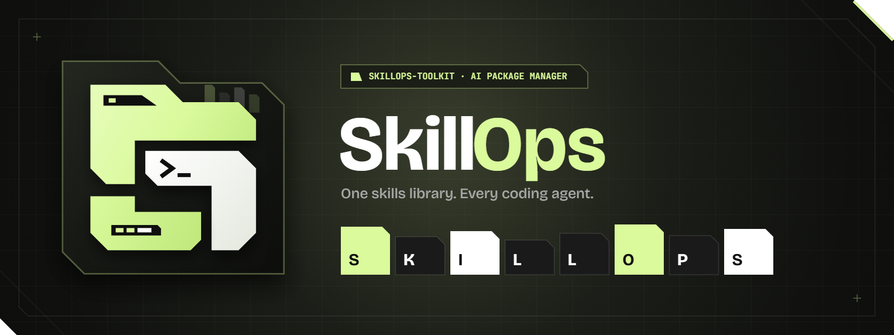

  

 

**One skills library. Every coding agent.**  
Install and manage AI coding **Skills (SKILL.md)** and **Subagents (SUBAGENT.md)** across **28+ AI IDEs & CLIs** — 100% local, zero API keys, protected by SHA-256 lockfiles and a 5-layer security gate.

---

### Quick Start

`ash
npx skillops-cli@latest add
`

### Official Repositories

| Repository | Role | Governance |
| :--- | :--- | :--- |
| **[skillops-toolkit/SkillOps](https://github.com/skillops-toolkit/SkillOps)** | Core NPX CLI Engine, Multi-IDE Transpiler, Security Gate & Curated Catalog (SKILL.md / SUBAGENT.md) | Protected main · CODEOWNERS (@OdevMatheus) · Automated Contract & Security CI |
| **[skillops-toolkit/skillops-website](https://github.com/skillops-toolkit/skillops-website)** | Official Web Showcase, Interactive Manifest Transpiler & Catalog Explorer | Protected main · CODEOWNERS (@OdevMatheus) · Next.js & TypeScript QA Gate |

### Open-Source Governance Rules

All repositories under **@skillops-toolkit** are 100% public and open-source under the MIT License while enforcing strict supply-chain and repository hygiene rules:
- **Protected main Branch**: Direct pushes, force-pushes, and branch deletions are blocked via GitHub Rulesets.
- **Mandatory Code Owner Review**: Every Pull Request requires review and approval from @OdevMatheus (.github/CODEOWNERS).
- **Semantic PR & Branch Discipline**: Branches must follow <type>/<short-kebab-description> and PR titles must follow lowercase imperative **Conventional Commits**.
- **5-Layer Supply-Chain Security**: Every catalog contribution undergoes YAML schema validation, prompt-injection & exfiltration scanning, and deterministic SHA-256 lockfile verification.